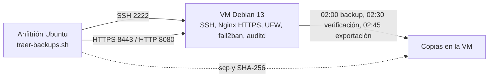

# Laboratorio de Servidor Linux Seguro

[](https://github.com/marttin1987/servidor-seguro/actions/workflows/shellcheck.yml)

## Resumen

Proyecto práctico de administración de sistemas Linux: un servidor Debian 13 en VirtualBox, configurado, endurecido, monitorizado y respaldado paso a paso. Cada etapa tiene su documento con los comandos usados, las pruebas y los resultados reales, incluidos los errores y cómo se resolvieron.

## Resultados

| Medida | Inicio | Actual |
| --- | --- | --- |
| Hardening index de Lynis | 68 | 79 |
| Sugerencias de Lynis | 54 | 31 |
| Acceso SSH | Contraseña | Solo clave pública |
| Web | HTTP | HTTPS (TLS 1.2 y 1.3) |
| Backups | Ninguno | Diarios, firmados, verificados, con restauración probada y copia fuera de la VM |

## Arquitectura



La VM usa red NAT de VirtualBox con redirección de puertos: `2222` a SSH, `8080` a HTTP y `8443` a HTTPS.

## Qué se implementó

| Área | Medidas | Documento |
| --- | --- | --- |
| Acceso | Clave pública, sin contraseñas, sin root por SSH, `AllowUsers`, sin reenvíos, `fail2ban` | [06](docs/06-hardening-ssh.md) |
| Red | Firewall UFW, módulos de red y almacenamiento desactivados, parámetros del kernel | [02](docs/02-firewall-ssh.md), [07](docs/07-mejoras-lynis.md) |
| Web | Nginx con HTTPS y redirección desde HTTP | [03](docs/03-nginx-acceso-web.md), [10](docs/10-https-nginx.md) |
| Auditoría | Lynis antes y después de las mejoras, `auditd`, actualizaciones automáticas | [05](docs/05-auditoria-lynis.md), [07](docs/07-mejoras-lynis.md) |
| Usuarios | Política de contraseñas, usuario `auditor` con mínimo privilegio | [09](docs/09-usuarios-permisos.md) |
| Backups | Compresión atómica, firma SHA-256, rotación, prueba de restauración, copia fuera de la VM | [08](docs/08-backups-restauracion.md), [11](docs/11-backups-fuera-de-la-vm.md) |
| Automatización | Reporte con semáforo y tareas de `cron` ejecutadas solo desde rutas de root | [12](docs/12-scripts-de-root-seguros.md) |

## Automatización

| Hora | Tarea |
| --- | --- |
| 02:00 | Backup de las configuraciones críticas |
| 02:30 | Verificación de las firmas |
| 02:45 | Exportación de la última copia |

Después, `scripts/traer-backups.sh` la trae al anfitrión y vuelve a verificar la firma. El reporte de estado se ejecuta cuando se necesita: `sudo ./scripts/reporte-servidor.sh`.

## Scripts

| Script | Función |
| --- | --- |
| `scripts/reporte-servidor.sh` | Semáforo de recursos, servicios, seguridad, actualizaciones y backups. Devuelve `0`, `1` o `2`. |
| `scripts/respaldar-configs.sh` | Prepara las configuraciones y llama a ATLAS para comprimir, firmar y rotar. |
| `scripts/exportar-backup.sh` | Deja la última copia lista para salir de la VM. |
| `scripts/traer-backups.sh` | Trae la copia al anfitrión y verifica su firma. |

Todos pasan ShellCheck en cada `push`. Los backups usan el proyecto [backups-rotatorios-atlas](https://github.com/marttin1987/backups-rotatorios-atlas).

## Decisiones

- No se cambió el puerto SSH: con red NAT no aporta protección real.
- No se puso contraseña a GRUB: es una VM de laboratorio sin acceso físico.
- No se instalaron módulos de Apache: el servidor web es Nginx.
- El usuario `auditor` lee registros pero no tiene `sudo` ni acceso por SSH.
- Root solo ejecuta scripts que están en carpetas de root.

## Limitaciones

- El certificado HTTPS es autofirmado: cifra, pero el navegador muestra una advertencia.
- La VM y el anfitrión comparten la misma máquina física; un esquema real llevaría la copia a otro equipo.
- Las copias no están cifradas y traerlas es manual.
- `cron` solo corre con la VM encendida.

## Estructura del repositorio

```text
configs/   configuración aplicada al servidor
docs/      un documento por etapa, del 00 al 12
scripts/   herramientas en Bash
```

## Documentación

- [Instalación y resolución de problemas](docs/00-instalacion.md)
- [Inventario inicial](docs/01-inventario.md)
- [Firewall y SSH](docs/02-firewall-ssh.md)
- [Despliegue y acceso web con Nginx](docs/03-nginx-acceso-web.md)
- [Diagnóstico de Nginx y recursos HTTP](docs/04-diagnostico-nginx.md)
- [Auditoría Lynis](docs/05-auditoria-lynis.md)
- [Endurecimiento de SSH](docs/06-hardening-ssh.md)
- [Mejoras a partir de Lynis](docs/07-mejoras-lynis.md)
- [Backups y restauración](docs/08-backups-restauracion.md)
- [Usuarios y permisos](docs/09-usuarios-permisos.md)
- [HTTPS en Nginx](docs/10-https-nginx.md)
- [Backups fuera de la VM](docs/11-backups-fuera-de-la-vm.md)
- [Scripts de root seguros](docs/12-scripts-de-root-seguros.md)

## Principios de trabajo

Cada etapa incluye explicación técnica, configuración, pruebas y documentación de los resultados reales. No se publican claves privadas, contraseñas ni otros secretos.
